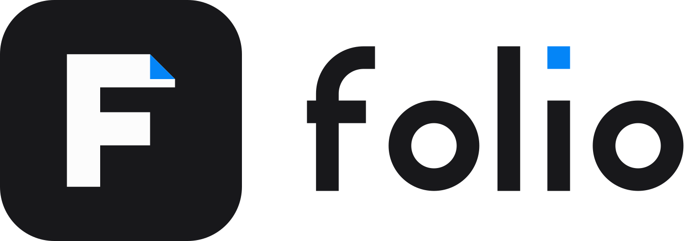
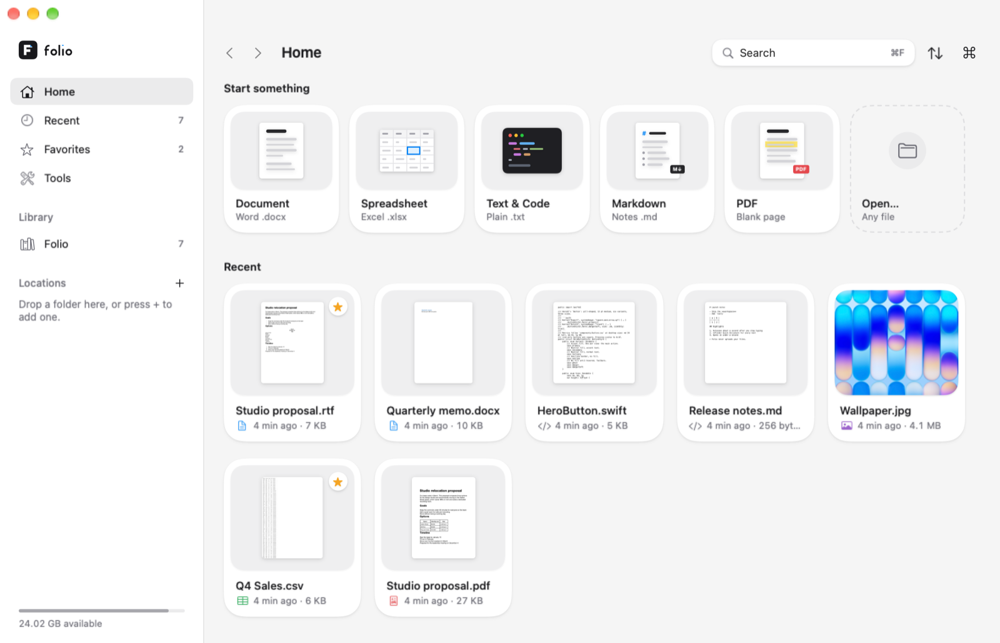
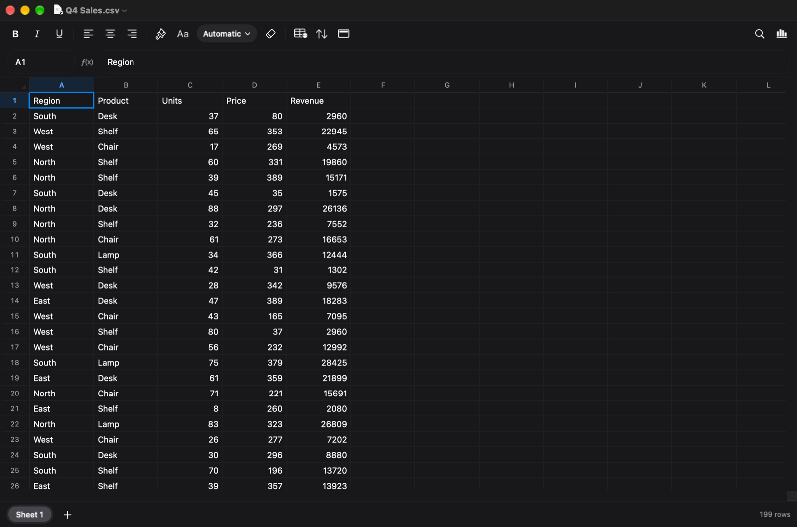
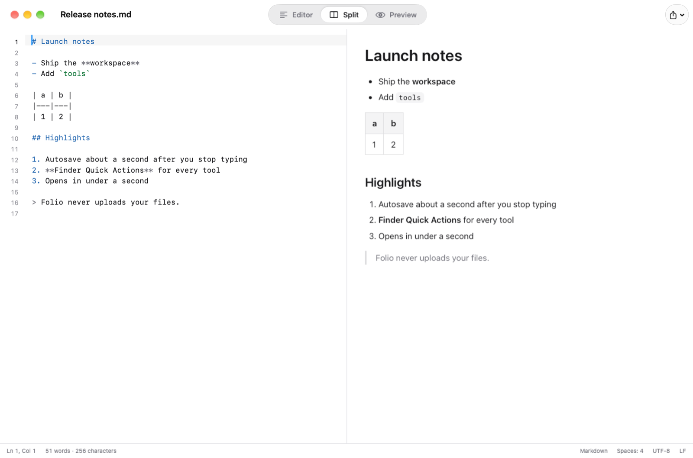
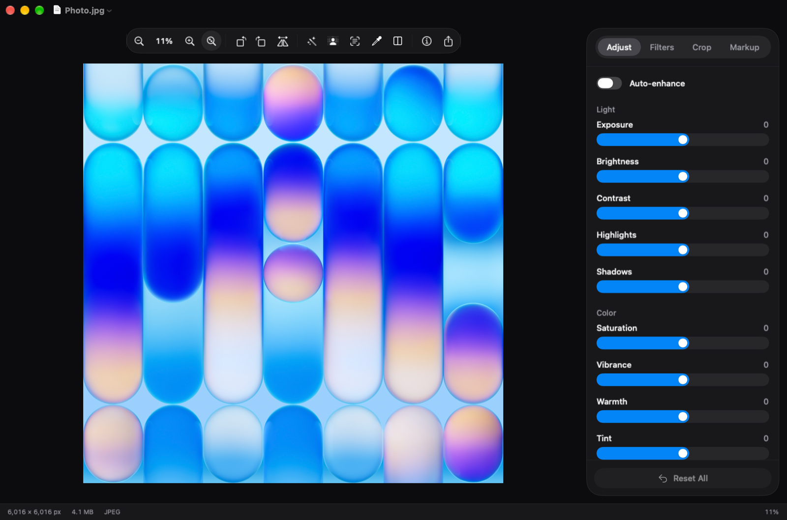
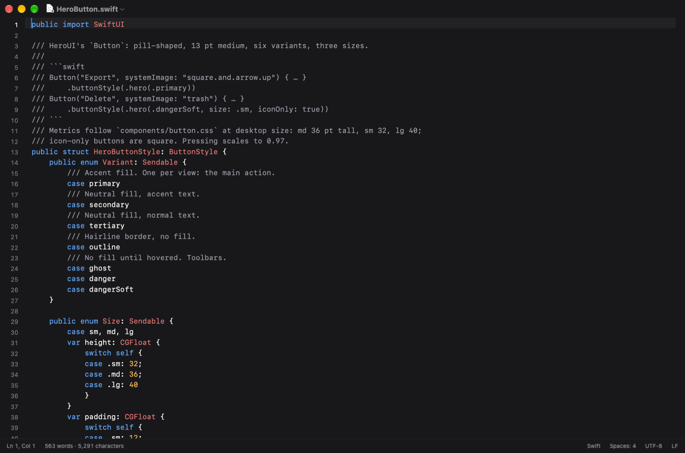
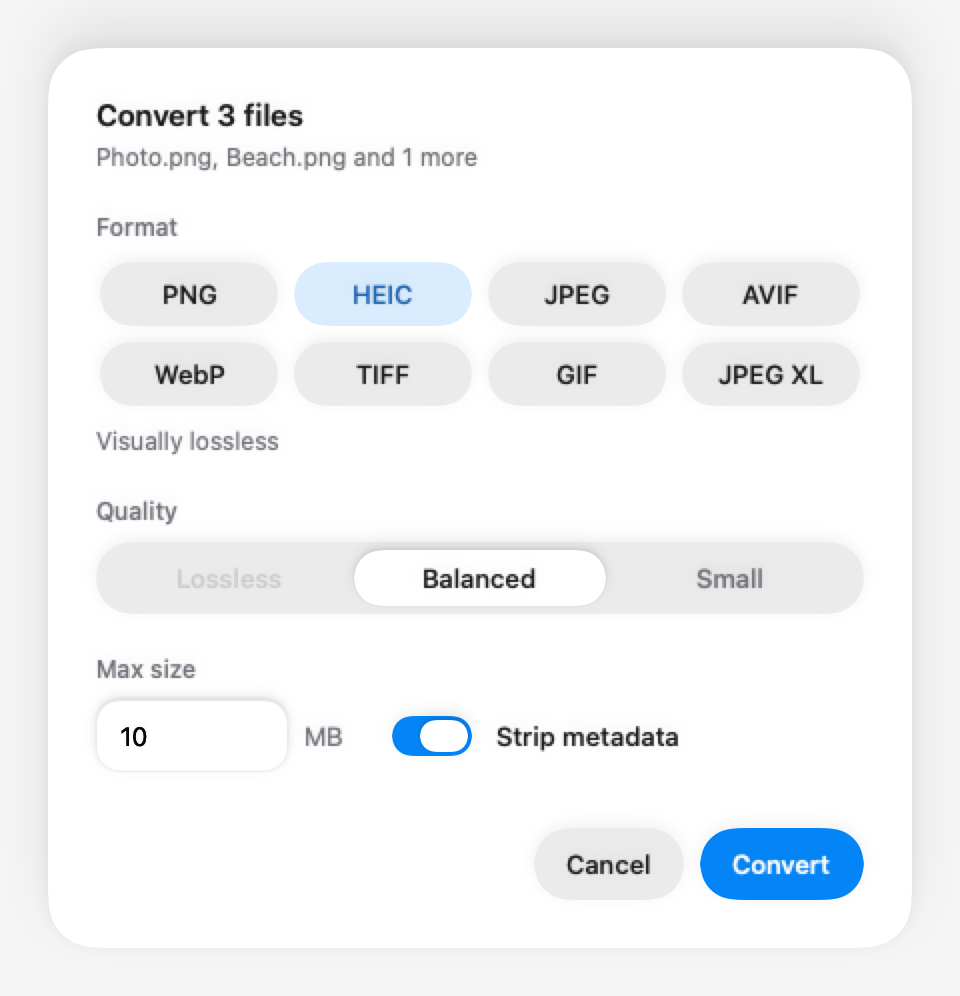
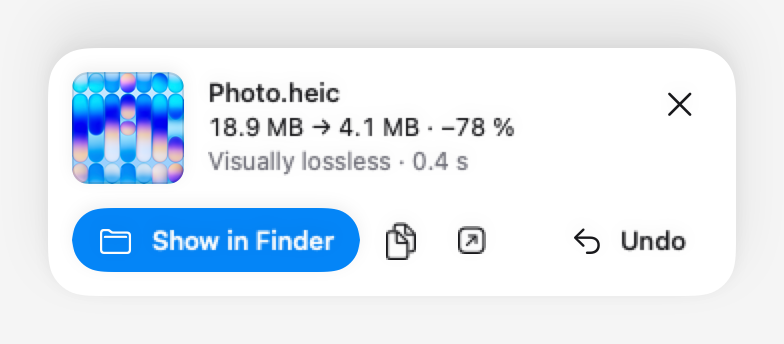
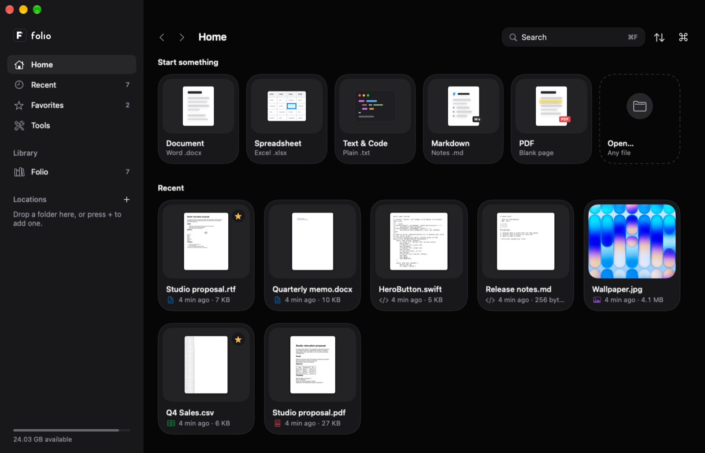

<p align="center">
  <picture>
    <source media="(prefers-color-scheme: dark)" srcset="brand/logo/folio-lockup-white.svg">
    
  </picture>
</p>

<p align="center">
  One fold. Every file.<br>
  A native Mac app that opens, edits and converts PDFs, documents, spreadsheets, images, code and media.<br>
  On-device, open source, and usable by your coding agent.
</p>

<p align="center">
  <a href="https://github.com/AryanM24/folio/releases/latest"><b>Download for Mac</b></a> ·
  <a href="#for-agents">For agents</a> ·
  <a href="#build-from-source">Build from source</a> ·
  <a href="docs/ARCHITECTURE.md">Architecture</a> ·
  <a href="CONTRIBUTING.md">Contributing</a> ·
  <a href="brand/README.md">Brand</a>
</p>

<p align="center">
  
</p>

<table>
  <tr>
    <td></td>
    <td></td>
  </tr>
  <tr>
    <td></td>
    <td></td>
  </tr>
  <tr>
    <td></td>
    <td></td>
  </tr>
</table>

## Convert anything it opens

Select files and press ⇧⌘C, right-click in Finder and choose **Quick Actions › Convert with Folio**, or drop them on Folio in the menu bar. Pick a format and one of three qualities: **lossless**, **balanced** or **small**.

<p align="center">
  
  
</p>

- **Lossless means checked.** Folio decodes what it wrote and compares pixels, audio samples, cells or text. If a format can't be lossless (HEIC, JPEG, AAC), it says so and suggests one that can, instead of quietly degrading.
- **Never bigger.** A compressed copy that isn't smaller is thrown away.
- **Never overwrites.** Results are new files next to the originals. Nothing is replaced or deleted.
- **The fast path first.** Changing a video's container copies the frames instead of re-encoding them. Batches run on every core. Video encodes on the media engine. A size limit (`--max-bytes 25MB`) picks the best quality that fits.
- **Every result is labelled**: size before and after, time taken, and whether it's lossless, visually lossless, smaller with some loss, or content only.

PDF, Word, RTF, OpenDocument, HTML, Markdown, text, Excel, CSV, TSV, JSON, HEIC, PNG, JPEG, AVIF, TIFF, GIF, WebP, JPEG XL, WAV, AIFF, FLAC, Apple Lossless, AAC, MP3, MOV and MP4. `folio formats` lists every pair.

### How fast

| Task | Folio | The usual way |
| --- | ---: | ---: |
| Convert 40 12-megapixel HEIC images to JPEG | **0.26 s** | 2.95 s (`sips`, one by one) |
| Shrink 10 s of 4K slow-motion video to share | **9.0 s** | 13.1 s (`avconvert`, HEVC 1080p) |
| Five minutes of audio, WAV to AAC | **1.0 s** | 1.2 s (`afconvert`) |

Apple M4, macOS 27, best of three. Reproduce with `make bench`.

## For agents

The app carries a `folio` command and a local [MCP](https://modelcontextprotocol.io) server, so Claude Code, Cursor, Codex or Claude Desktop can convert, compress, preview and read your files with the same engine. Connect them from **Folio › Settings › Agents**, or:

```sh
claude mcp add folio -- /Applications/Folio.app/Contents/Helpers/folio mcp
```

Then just ask: *"Shrink the screenshots in docs/ so the PR stays under 10 MB."* Folio answers with each output's size, fidelity and verification as JSON. It has no delete, overwrite, shell or network tools, and it only touches folders you allow. See [docs/AGENTS.md](docs/AGENTS.md) for every tool, the CLI and the security model.

```sh
folio convert *.heic --to jpeg --quality balanced
folio convert talk.mov --to mp4 --max-bytes 25MB
folio extract contract.pdf --pages 1-5
folio inspect clip.mov
```

### Why not just…

- **…use Preview or Finder's Convert Image?** Three image formats, no batch quality control, no size target, no video, audio or documents.
- **…use `sips`, `textutil`, `afconvert` and `avconvert`?** Four tools with four flag styles. `textutil` can't write PDF, `avconvert` presets often make videos *bigger*, none of them checks the result, and they overwrite.
- **…let the agent write a script?** It usually starts with `pip install` or `brew install ffmpeg`, picks quality settings by guess, rarely checks the output, and writes a new script every time. Folio is one signed binary with tested recipes and a stable JSON contract.

## A home for your files

<p align="center">
  
</p>

Folio opens to its **workspace**: start a new document, spreadsheet, note or PDF in one click, then pick up recent work across your Mac. Files stay ordinary files in folders you choose (new work goes to *~/Documents/Folio*); favorites are a Finder tag, so the star shows up in Finder too. Search, filter by kind, preview with Space, rename, move, share or trash with Undo, run tools on a selection, and press ⌘K for everything else.

## What it edits

| | |
| --- | --- |
| **PDF** | Annotate, highlight, draw, sign, fill forms, redact for real, recognize text in scans, and insert, delete, rotate, reorder or extract pages. |
| **Documents** | Word (.docx), RTF, ODT and HTML, with styles, lists, tables, images, a page view, Find & Replace and Writing Tools. |
| **Spreadsheets** | Excel (.xlsx), CSV, TSV and ODS, with nearly 50 functions, multiple sheets, formatting, sorting, clipboard that works with Numbers and Excel, and charts. |
| **Images** | Non-destructive adjustments and filters, crop and straighten, resize, markup, background removal and Live Text. |
| **Text and code** | Syntax highlighting for 20+ languages, a live Markdown preview, JSON formatting, and the file's own encoding and line endings preserved. |
| **Audio and video** | Playback, lossless trimming, export presets, audio extraction, frame grabs and waveforms. |

Plus one-step **tools**: combine, split, rotate, number or watermark PDFs, cut out backgrounds, merge CSVs, make GIFs and more. Run them from the workspace, from *File › Tools*, from Finder's *Quick Actions*, or through `folio run`.

## Built for the Mac

- **Never loses your work.** Folio saves about a second after you stop typing. Every save is atomic, and *File › Revert To* browses every earlier version.
- **Opens and quits in under a second.** That's a budget enforced by `make launch-time`, not a hope.
- **Uses Apple's own engines:** PDFKit, the Cocoa text system, Core Image, AVFoundation and Vision. Undo, Find, Services, tabs, full screen, iCloud Drive, Continuity Camera, dictation and dark mode work as they do everywhere else on your Mac.
- **Finder manners.** The workspace speaks Spotlight, Quick Look, Finder tags, the Trash and drag and drop, and every action has a menu item and a shortcut.
- **Private by design.** No account, no analytics, no network requests at all. Your files never leave your Mac.

## Install

Download `Folio-0.2.0.dmg` from the [latest release](https://github.com/AryanM24/folio/releases/latest), open it and drag Folio to Applications. It needs macOS 15 or later on Apple silicon.

This build is signed with a Developer ID but isn't notarized yet, so the first time you open it macOS says it can't check it for malware. Open **System Settings › Privacy & Security**, scroll to the message about Folio and click **Open Anyway**. You only do this once. Or, in Terminal:

```sh
xattr -dr com.apple.quarantine /Applications/Folio.app
```

## Build from source

Requirements: macOS 15 or later, and Swift 6.2 (Xcode 26 or the Command Line Tools).

```sh
git clone https://github.com/AryanM24/folio
cd folio
make run
```

| Command | |
| --- | --- |
| `make run` | Build `build/Folio.app` (debug) and open it |
| `make app` | Release build |
| `make test` | Run all test suites |
| `make launch-time` | Check the launch and quit budgets |
| `make bench` | Time conversions against `sips`, `afconvert` and `avconvert` |
| `make mcp-check` | Check the MCP server answers in under 100 ms |
| `scripts/snapshot.sh <files>` | Open files and save window screenshots to `build/snapshots/` |

No Xcode project is needed. Xcode users can open `Package.swift`.

## How it's built

Folio is a SwiftUI document-based app, with one Swift module per editor and a shared conversion engine:

```
Folio (app) ──┬─ FolioPDF      PDFKit
              ├─ FolioDocs     NSTextView: docx, rtf, odt, html
              ├─ FolioSheets   Formula engine, xlsx/csv/ods codecs, virtualized grid
              ├─ FolioImage    Core Image pipeline, Vision
              ├─ FolioCode     TextKit, incremental tokenizers, Markdown
              ├─ FolioMedia    AVFoundation
              ├─ FolioKit      Shared types, tools, HeroUI design system
              └─ FolioAgent ── FolioConvert   The engine: ImageIO, PDFKit, AVFoundation, VideoToolbox
folio (CLI, MCP) ─┘                           and the editors' own codecs. No UI.
```

Read [docs/ARCHITECTURE.md](docs/ARCHITECTURE.md) for how saving, concurrency and tools work, [docs/DESIGN.md](docs/DESIGN.md) for the design system, and [docs/editors/](docs/editors) for each editor.

## Contributing

Issues and pull requests are welcome. Start with [CONTRIBUTING.md](CONTRIBUTING.md). Please report security issues privately; see [SECURITY.md](SECURITY.md).

## License

[MIT](LICENSE). The visual design is a port of [HeroUI](https://heroui.com) (MIT).
