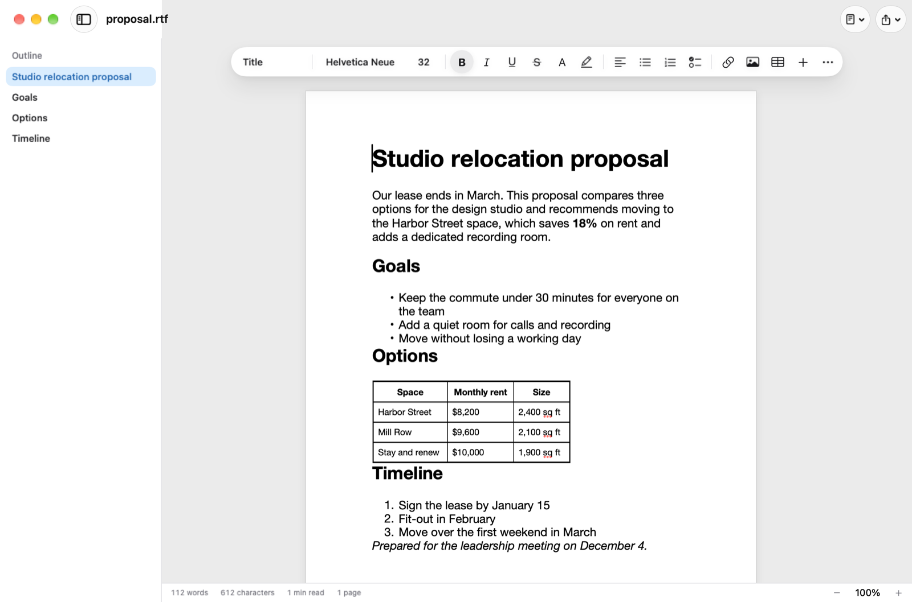
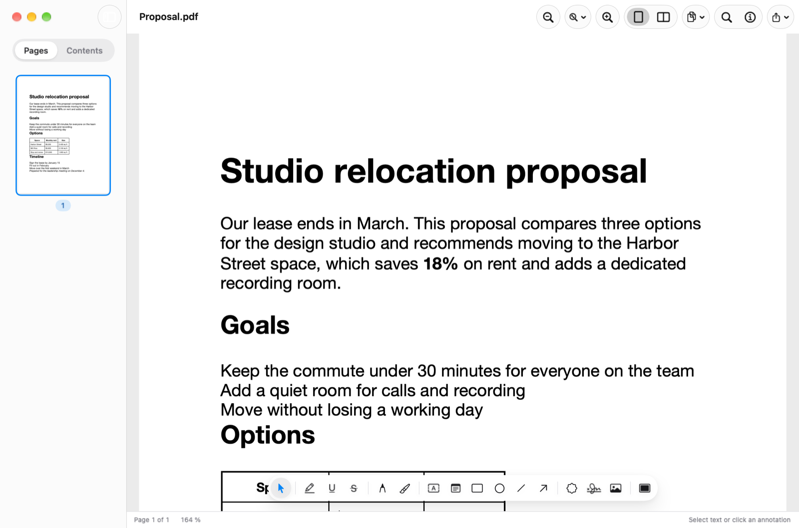

<p align="center">
  
</p>

<h1 align="center">Folio</h1>

<p align="center">
  Every file you edit, in one native Mac app.<br>
  PDFs, documents, spreadsheets, images, code and media. On-device, open source, fast.
</p>

<p align="center">
  <a href="https://github.com/AryanM24/folio/releases/latest"><b>Download for Mac</b></a> ·
  <a href="#build-from-source">Build from source</a> ·
  <a href="docs/ARCHITECTURE.md">Architecture</a> ·
  <a href="CONTRIBUTING.md">Contributing</a>
</p>

<p align="center">
  
</p>

<table>
  <tr>
    <td></td>
    <td></td>
  </tr>
  <tr>
    <td></td>
    <td></td>
  </tr>
</table>

## What it edits

| | |
| --- | --- |
| **PDF** | Annotate, highlight, draw, sign, fill forms, redact for real, recognize text in scans, and insert, delete, rotate, reorder or extract pages. |
| **Documents** | Word (.docx), RTF, ODT and HTML, with styles, lists, tables, images, a page view, Find & Replace and Writing Tools. |
| **Spreadsheets** | Excel (.xlsx), CSV, TSV and ODS, with nearly 50 functions, multiple sheets, formatting, sorting, clipboard that works with Numbers and Excel, and charts. |
| **Images** | Non-destructive adjustments and filters, crop and straighten, resize, markup, background removal and Live Text. |
| **Text and code** | Syntax highlighting for 20+ languages, a live Markdown preview, JSON formatting, and the file's own encoding and line endings preserved. |
| **Audio and video** | Playback, lossless trimming, export presets, audio extraction, frame grabs and waveforms. |

Plus one-step **tools**: combine PDFs, images to PDF, compress images, convert spreadsheets, extract audio and more. Run them from the Welcome window, from *File › Tools*, or by right-clicking files in Finder (*Quick Actions*).

## Built for the Mac

- **Never loses your work.** Folio saves about a second after you stop typing. Every save is atomic, and *File › Revert To* browses every earlier version.
- **Opens and quits in under a second.** That's a budget enforced by `make launch-time`, not a hope.
- **Uses Apple's own engines:** PDFKit, the Cocoa text system, Core Image, AVFoundation and Vision. Undo, Find, Services, tabs, full screen, iCloud Drive, Continuity Camera, dictation and dark mode work as they do everywhere else on your Mac.
- **Private by design.** No account, no analytics, no network requests at all. Your files never leave your Mac.

## Build from source

Requirements: macOS 15 or later, and Swift 6.2 (Xcode 26 or the Command Line Tools).

```sh
git clone https://github.com/AryanM24/folio
cd folio
make run
```

| Command | |
| --- | --- |
| `make run` | Build `build/Folio.app` (debug) and open it |
| `make app` | Release build |
| `make test` | Run all test suites |
| `make launch-time` | Check the launch and quit budgets |
| `scripts/snapshot.sh <files>` | Open files and save window screenshots to `build/snapshots/` |

No Xcode project is needed. Xcode users can open `Package.swift`.

## How it's built

Folio is a SwiftUI document-based app, with one Swift module per editor:

```
Folio (app)  ─┬─ FolioPDF      PDFKit
              ├─ FolioDocs     NSTextView: docx, rtf, odt, html
              ├─ FolioSheets   Formula engine, xlsx/csv/ods codecs, virtualized grid
              ├─ FolioImage    Core Image pipeline, Vision
              ├─ FolioCode     TextKit 2, incremental tokenizers, Markdown
              ├─ FolioMedia    AVFoundation
              └─ FolioKit      Shared types, tools, HeroUI design system
```

Read [docs/ARCHITECTURE.md](docs/ARCHITECTURE.md) for how saving, concurrency and tools work, [docs/DESIGN.md](docs/DESIGN.md) for the design system, and [docs/editors/](docs/editors) for each editor.

## Contributing

Issues and pull requests are welcome. Start with [CONTRIBUTING.md](CONTRIBUTING.md). Please report security issues privately; see [SECURITY.md](SECURITY.md).

## License

[MIT](LICENSE). The visual design is a port of [HeroUI](https://heroui.com) (MIT).
