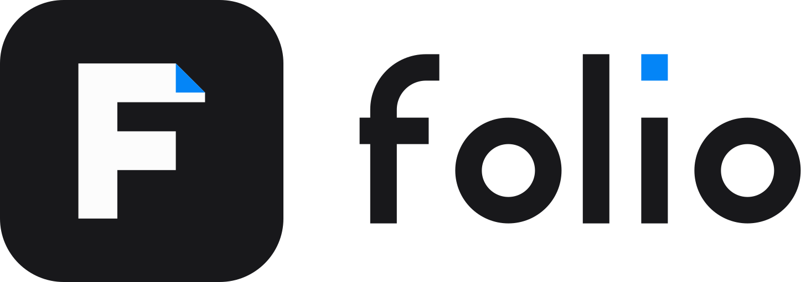

# Folio brand

The full guidelines board is at **[folio-kappa-lac.vercel.app/brand](https://folio-kappa-lac.vercel.app/brand/)**. This page is the written version, plus the source files.

## The idea

A *folio* is a single sheet folded once to make pages. Folio does the same for your files: one native app holds every format you edit.

The mark is that idea reduced to one shape: **an F cut from a single sheet, with its top corner folded over.** The F is the name. The fold is the paper, and the action of making one thing hold many. The reverse of the sheet is Folio Blue, so blue only ever appears where something has been folded or acted on.

Brand line: **One fold. Every file.**

## Files

| File | Use |
| --- | --- |
| `logo/folio-mark.svg` | Primary mark: app icon tile on Eclipse. Use by default. |
| `logo/folio-mark-light.svg` | Mark on a Snow tile, for dark backgrounds where the Eclipse tile disappears |
| `logo/folio-glyph.svg`, `folio-glyph-white.svg` | The folded F alone, for tight spaces and embossing |
| `logo/folio-wordmark.svg`, `folio-wordmark-white.svg` | The wordmark alone |
| `logo/folio-lockup.svg`, `folio-lockup-white.svg` | Mark plus wordmark, horizontal |
| `document-icon.svg` | Template for file-type icons. Change only the label. |

The app icon is drawn from the same coordinates by `scripts/make-icon.swift`. After changing any geometry, run `make brand` to copy the files into the website and regenerate the icon.

## Construction

All of it sits on a 64-unit tile with an 8-unit grid.

- **Tile:** 64 × 64, corner radius 14.4 (22.5%).
- **F:** stem 8 wide, from y 16 to 48. Top arm 8 tall (y 16 to 24) and 26 long. Middle arm 8 tall (y 30 to 38), ending at x 40. The gap between the arms is 6.
- **Fold:** a right triangle from (40, 16) to (46, 22). It begins exactly where the middle arm ends, so the two line up vertically. A 2-unit strip of paper shows below the flap, which is what makes it read as a fold rather than a flag.
- **Placement:** the glyph is scaled 1.1× about the tile centre, with its optical centre at x 33, so it sits optically centred and fills about 55% of the tile, like system app icons.
- **Wordmark:** geometric lowercase drawn from strokes, not set in a font. It uses a 5-unit stroke with square ends (the F's corners), true-circle bowls, x-height 20 and ascender 32. The dot on the i is a 5-unit square in Folio Blue: the fold at text size.
- **Lockup:** the wordmark's height is 60% of the tile, with a gap of one quarter of the tile.

## Clear space and size

- Keep clear space of one arm (⅛ of the tile) around the mark and the lockup.
- Minimum sizes: the icon 16 px, the wordmark 48 px wide, the lockup 120 px wide.

## Color

| Name | Hex | Role |
| --- | --- | --- |
| Eclipse | `#18181B` | The tile, ink and dark surfaces |
| Snow | `#FCFCFC` | The sheet, and light surfaces |
| Folio Blue | `#0485F7` | **Only** the fold, the i's dot and primary actions |
| Paper | `#F2EFE8` | Warm editorial backgrounds (brand line, print) |
| Graphite | `#71717A` | Secondary text, captions |

These match the app's HeroUI-based tokens in [docs/DESIGN.md](../docs/DESIGN.md). Folio Blue is the HeroUI accent, and Eclipse and Snow are its foreground and background extremes. On the web, use `#0070E0` for filled buttons that carry white text: it passes WCAG AA, while `#0485F7` doesn't at body sizes.

## Type

- **Interface and marketing:** SF Pro, the system font, used via `-apple-system` and `.system()`. Display 600 for headlines with tight tracking (−3% to −5%); Text 400 and 500 for everything else.
- **Code and figures:** SF Mono.
- The wordmark is artwork, never typed. Don't set "folio" in a font to stand in for it.

## Don't

- Don't rotate, skew, outline or add effects (shadows, glows, gradients) to the mark.
- Don't recolor the fold, or use Folio Blue as a large fill or a background wash.
- Don't move the fold to another corner, or add folds elsewhere.
- Don't redraw the wordmark or put the mark inside another shape.
- Don't use the mark to suggest endorsement of a fork or other product.

## License

The files are part of this repository and released under the [MIT license](../LICENSE). The Folio name and mark identify this project, so forks should use their own.
